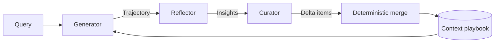

# Agentic Context Engineering (ACE)

**Paper:** *Agentic Context Engineering: Evolving Contexts for Self-Improving Language Models*
**Authors:** Qizheng Zhang, Changran Hu, et al. (Stanford University, SambaNova Systems, UC Berkeley)
**Venue:** ICLR 2026
**Links:** [arXiv:2510.04618](https://arxiv.org/pdf/2510.04618) | [Code: github.com/ace-agent/ace](https://github.com/ace-agent/ace)

> **Terminology:** "Agent context engineering" usually means the general practice of managing what an agent sees. ACE is one specific framework. It uses agents to improve context automatically over time.

## Summary

ACE improves an LLM application by changing its context rather than its weights. It treats context as an evolving **playbook**: a structured list of strategies, domain concepts, and common failure modes. After each attempt at a task, the system reflects on what happened and makes small, targeted updates to the playbook. It does not rewrite the whole context.

The paper's central claim is that LLMs often perform better with long, detailed contexts than with concise summaries, because the model can work out what is relevant at inference time.

## The problems ACE addresses

| Problem | What happens | Why it matters |
|---|---|---|
| **Brevity bias** | Prompt optimizers converge on short, generic instructions | Domain heuristics, tool-use rules, and known failure modes get dropped |
| **Context collapse** | An LLM asked to rewrite a large context compresses it drastically | Accumulated knowledge can disappear in a single step |

**Example of context collapse:** In an AppWorld case study using Dynamic Cheatsheet, a context of 18,282 tokens scoring 66.7 shrank to 122 tokens in one step. Accuracy fell to 57.1, below the 63.7 achieved with no adaptation at all.

## How ACE works



### Three roles

| Role | Job |
|---|---|
| **Generator** | Solves the task using the playbook and notes which items helped or misled it |
| **Reflector** | Critiques the attempt and extracts concrete lessons, optionally over several rounds |
| **Curator** | Turns those lessons into compact delta entries |

The merge itself uses lightweight, non-LLM logic. This is the key safeguard: because no LLM rewrites the whole playbook, it has no opportunity to collapse it.

### Three key mechanisms

1. **A dedicated Reflector:** Separates evaluating an attempt from updating the context.
2. **Incremental delta updates:** Replace full rewrites with small, localized edits.
3. **Grow-and-refine:** Adds new items, updates existing ones in place, and removes redundant ones.

### Playbook items ("bullets")

Each bullet has two parts:

- **Metadata:** A unique ID and counters for how often it was marked helpful or harmful.
- **Content:** A small unit of knowledge, such as a reusable strategy, a domain concept, or a common failure mode.

Illustrative example (the format is not taken from the paper):

```text
[api-pagination-0007] helpful=12 harmful=1
Loop through pages until the API returns no results. Do not use a fixed page limit.
```

This structure allows:

- **Localization:** Only the relevant bullets change.
- **Fine-grained retrieval:** The Generator can focus on the most pertinent items.
- **Incremental adaptation:** Merging, pruning, and de-duplication stay efficient.

### Controlling growth

ACE removes duplicates by comparing bullets using semantic embeddings. This can run in one of two ways:

- **Proactively:** After every delta update.
- **Lazily:** Only when the context window is exceeded.

### The update loop

```text
for each sample:
    trajectory = Generator(query, playbook)
    feedback   = execution result and/or ground-truth label, if available
    insights   = Reflector(trajectory, feedback, playbook)
    deltas     = Curator(insights, playbook)
    playbook   = deterministic_merge(playbook, deltas)
    playbook   = deduplicate(playbook)  # proactive, or lazily when context is full
```

### Offline and online adaptation

| Mode | Typical use | How it runs |
|---|---|---|
| **Offline** | Optimizing a system prompt | Learns on a training split, then is tested separately. Can make multiple passes over the same samples. |
| **Online** | Evolving agent memory at test time | Predicts on each sample, then updates the context from it |

## Results

Figures below use DeepSeek-V3.1 as the base model unless noted. Each comparison reports the configuration shown in the paper's tables.

### Headline gains

- **Agents:** Average gain of 10.6% over baselines.
- **Financial benchmarks (FiNER and Formula):** Average gain of 8.6%. The paper's key findings call this "domain-specific", but the figure is the mean of the finance comparisons only.
- **Adaptation latency:** 86.9% lower on average.

### AppWorld (agent benchmark)

Average score across task and scenario goal completion on both test splits:

| Method | Setting | Ground-truth labels | Average |
|---|---|---|---|
| ReAct (base) | None | n/a | 42.4 |
| ReAct + ICL | Offline | Yes | 46.0 |
| ReAct + GEPA | Offline | Yes | 46.4 |
| **ReAct + ACE** | Offline | Yes | **59.4** |
| **ReAct + ACE** | Offline | No | **57.2** |
| ReAct + DC (CU) | Online | No | 51.9 |
| **ReAct + ACE** | Online, with offline warmup | No | **59.5** |

The best leaderboard system at the time of submission, IBM CUGA, scored 60.3 using GPT-4.1. ACE reached a similar level with a smaller open-source model. With online adaptation, ACE beat CUGA on the harder test-challenge split by 8.4 points on task completion and 0.7 on scenario completion. The authors note in a footnote that CUGA is only a rough reference point, not a methodological baseline.

### Domain-specific benchmarks

| Task | Base | Best baseline | ACE |
|---|---|---|---|
| FiNER (finance, offline) | 70.7 | 73.5 (GEPA) | **78.3** |
| Formula (finance, offline) | 67.5 | 71.5 (GEPA) | **85.5** |
| DDXPlus (medical, offline) | 75.2 | 76.4 (GEPA) | **90.2** |
| BIRD-SQL (text-to-SQL, offline) | 47.8 | 52.2 (GEPA) | **52.9** |

On BIRD-SQL, GEPA beat ACE on the Moderate and Challenging subsets. ACE's overall lead came mainly from the Simple subset.

### Cost and speed

| Comparison | Latency | Other |
|---|---|---|
| Offline AppWorld vs GEPA | 82.3% lower | 75.1% fewer rollouts |
| Online FiNER vs DC | 91.5% lower | 83.6% lower token cost |

- **During adaptation:** ACE used 80.8% fewer input tokens and 83.6% fewer output tokens than GEPA on AppWorld.
- **During evaluation:** ACE used 117.4% more input tokens than GEPA because its playbook is longer.
- **With prompt caching:** In a GPT-5.1 study, 91.8% of input tokens came from cache, cutting billed input-token cost by 82.6%.

### What each design choice contributes

Offline AppWorld, with ground-truth labels:

| Configuration | Average |
|---|---|
| ACE without Reflector or multiple epochs | 55.1 |
| ACE without multiple epochs | 56.8 |
| Full ACE | 59.4 |

Online AppWorld improved from 56.1 to 59.5 by adding an offline warmup.

Incremental updates had the largest measured effect. On the test-normal split, removing them lowered the average from 70.3 to 56.9.

## Limitations

- **Feedback quality is critical:** Without reliable signals, the context can be polluted. On FiNER, unlabeled online ACE scored 67.3, below the base model's 70.7. Unlabeled learning worked much better where execution feedback was available.
- **It depends on the Reflector:** Weak reflection can make the context noisy or harmful. ACE did stay above the base model with a weaker Reflector, and fell below it (66.7) only when harmful reflections were injected at every step.
- **Not every task needs it:** Tasks such as HotPotQA can benefit more from concise, high-level instructions, and Game of 24 may need only one reusable rule.
- **Gains vary by model:** Llama-3.3-70B-Instruct saw smaller gains, which the authors attribute to noisier feedback from weaker models.

### Points to check when reading the paper

- **Rollout figures depend on the setup:** The main results report 75.1% fewer rollouts than GEPA (357 vs 1,434), but the fine-grained cost table shows 42.6% more (2,075 vs 1,455) with 1 epoch and 1 reflection round. Its token savings still hold there.
- **"Works without labels" has limits:** "Works without labels" is strongest for agent tasks with execution feedback. It does not apply across every task.
- **"%" usually means points:** Most reported gains are point differences between scores, not relative increases. One exception is the delta-update ablation in Appendix C.2: -11.7% and -27.8% are relative drops, matching gaps of 8.9 and 17.9 points in Table 18.
- **"Matches" versus "surpasses":** The abstract says ACE matches IBM CUGA on the overall average, while the introduction says it surpasses CUGA. The figures support the abstract: 59.4 vs 60.3 overall, with the lead only on test-challenge.
- **De-duplication sensitivity:** The paper calls the effect mild, but FiNER scores were not monotonic: 77.0 at 50%, 73.9 at 70%, and 78.6 at 90%.

## Suggested starting settings

The paper reports stable results across these ranges:

| Setting | Range | Note |
|---|---|---|
| Reflection rounds | 3–5 | 1 under-extracted insights, and 10 could reduce performance |
| De-duplication threshold | 50–90% | Results on FiNER changed only mildly overall |
| Pruning trigger | 10K–100K tokens | Performance on FiNER was stable |

## When to consider ACE

**Good fit:**

- Multi-step agents with complex tool use
- Tasks that depend on detailed domain knowledge or edge cases
- Systems with reliable feedback, such as tests, execution results, or labels

**Weaker fit:**

- Simple tasks that a short instruction can cover
- Tasks with fixed strategies
- Systems with no trustworthy feedback signal

## Related methods

| Method | Approach | How ACE differs |
|---|---|---|
| **GEPA** | Evolves and selects full prompts | Updates an itemized playbook incrementally |
| **Dynamic Cheatsheet** | Rewrites a shared memory | Uses delta updates, avoiding full rewrites and collapse |
| **MIPROv2** | Optimizes instructions and demonstrations together | Accumulates knowledge rather than searching for one optimized prompt |
| **ICL** | Places demonstrations in the prompt | Distills lessons from experience rather than supplying fixed examples |

## Source

Zhang, Q., Hu, C., et al. (2026). *Agentic Context Engineering: Evolving Contexts for Self-Improving Language Models.* ICLR 2026. [arXiv:2510.04618v3](https://arxiv.org/pdf/2510.04618)
